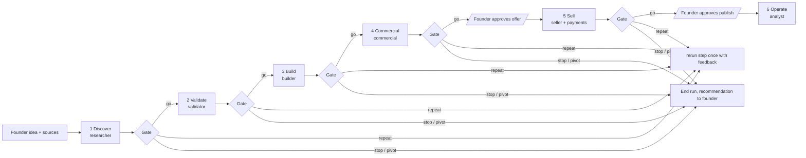

# Architecture

## Overview

launchpad is a sequential pipeline of six agents, one per phase, run by [orchestrator.py](orchestrator.py). Every agent reads the shared context (the idea, founder-given sources, earlier phases' results), calls a local open-weight model through Ollama, and returns JSON with a summary, role-specific details, evidence (each claim with a source URL or `ASSUMPTION`) and a confidence score. A gate after every phase decides go / repeat / pivot / stop. Outbound actions require the founder's approval in code. Every agent action is appended to `decision_log.json`.



## Phases

### Phase 1: Discover
- **Agent:** `agents/researcher.py`, prompt `prompts/researcher.md`.
- **Tools:** fetches founder-given source URLs (plain text, truncated); product-category screen in `guardrails.py`.
- **Method:** screens out disallowed categories first (STOP), then asks the model for ranked opportunities grounded in the sources.
- **Output:** `outputs/phase1_step1_opportunities.md`, `outputs/phase1_gate_decision.md`.

### Phase 2: Validate
- **Agent:** `agents/validator.py`. **Method:** target segment, current alternatives, competitor prices, demand signals, risks. The prompt tells the model that stopping early is a good outcome.
- **Output:** `outputs/phase2_step1_validation.md`, gate decision.

### Phase 3: Build
- **Agent:** `agents/builder.py`. **Method:** smallest sellable digital product: format, at most five core features, out-of-scope list, build steps and the first deliverable's outline.
- **Output:** `outputs/phase3_step1_product_spec.md`, gate decision.

### Phase 4: Commercial setup
- **Agent:** `agents/commercial.py`. **Method:** price based on Phase 2 competitor prices, what is included, refund policy, terms summary.
- **Approval:** `approve_offer_and_price`; the run ends if the founder rejects.
- **Output:** `outputs/phase4_step1_offer.md`, gate decision.

### Phase 5: Sell, deliver, get paid
- **Agent:** `agents/seller.py` drafts landing-page copy, channels and an outreach draft; `guardrails.copy_violations` blocks income promises, testimonials, scarcity and countdowns.
- **Approval:** `publish_landing_page` (publishing itself is MOCKED). Checkout links and refunds each need their own approval (see Sale to cash).
- **Output:** `outputs/phase5_step1_landing_page.md`, gate decision, `outputs/payment_test_log.md`.

### Phase 6: Operate and learn
- **Agent:** `agents/analyst.py`. **Method:** reviews the run and recommends metrics, changes and the next experiment.
- **Output:** `outputs/phase6_step1_learnings.md`, gate decision.

## Gates

Implemented in [gates.py](gates.py). Each gate checks the evidence the phase's agent returned:

| Check | Rule |
|---|---|
| Blocked (disallowed category, copy that breaks limits) | **stop** |
| No evidence, < 20% of claims sourced, or confidence < 0.3 | **stop** (weak evidence) |
| >= 50% of claims sourced and confidence >= 0.6 | **go** |
| Mixed, and the agent suggests a pivot | **pivot** (run ends, suggestion goes to the founder) |
| Mixed, first attempt | **repeat** (step reruns once with the gate's feedback) |
| Mixed after the retry | **stop** |

Agents may cite only URLs present in the provided sources; any other citation is rewritten to `ASSUMPTION` before the gate runs, so unsourced claims cannot pass as evidence.

## Sale to cash

All of this runs against a **MOCKED** provider (`payments.py`); no money moves.

```
founder approves ──> create_checkout ──> order (open, mock://checkout/<id>)
                                              │
              payment.succeeded webhook ──────┤  (event id recorded)
                                              ├─> payment + fee recorded, order paid
                                              └─> delivery.grant_access (once per order)
       same event id again ──> "duplicate", ignored (no second delivery)
founder approves refund ──> refund.succeeded ──> delivery.revoke_access
reconcile: per order gross - fee - refund = net; sum = expected payout; flags mismatches
```

- **Payment triggers delivery:** `payments.handle_event` grants access on `payment.succeeded`.
- **Refund revokes access:** `refunds.request_refund` (founder-approved) emits `refund.succeeded`, which revokes the grant.
- **Idempotency:** processed event ids are stored, and grants are keyed by order id, so neither a repeated webhook nor a second grant call delivers twice.
- **Reconciliation:** `reconcile.py` matches orders, payments, fees and refunds, computes the expected payout, and flags paid-without-payment, amount mismatches and refunded-but-still-active access.

## Data flow

1. Founder supplies the idea and source URLs (CLI).
2. Orchestrator builds a context dict; each phase adds its summary and details.
3. Agents send the context to the local model and return JSON; citations are checked against the sources.
4. Each phase writes `outputs/phase<N>_step1_<name>.md` and `outputs/phase<N>_gate_decision.md`.
5. Every action, gate and approval is appended to `decision_log.json` (`action`, `sources`, `model`, `cost`, `approved_by`).
6. Payment state (orders, grants, refunds, processed events) lives in `data/state.json` (untracked).

## Built vs. stubbed

| Part | State |
|---|---|
| Six agents, orchestrator, gates, approvals, guardrails, decision log | Built |
| Delivery, refunds, idempotency, reconciliation logic | Built |
| Payment provider, fees, payouts | MOCKED |
| Publishing the landing page | MOCKED |
| Web search beyond founder-given URLs | STUBBED |

## Roadmap

1. Web search with citations (free tier or self-hosted) for Discover and Validate.
2. Small web UI for founder approvals alongside the CLI.
3. Adapter for a payment provider in test mode, keeping the same webhook handler.
4. Agent evals and guardrail trick prompts under `evals/`.
