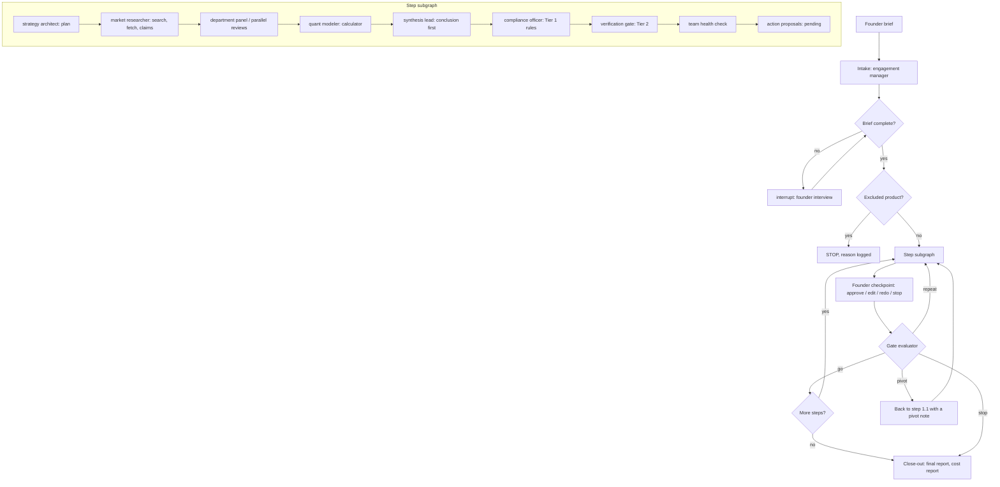

# Architecture

## Overview

launchpad is a consulting firm in a box. The founder (the client) submits a brief. The firm's agents take it through six phases: Discover, Validate, Build, Commercial setup, Launch, and Operate and learn. Along the way they design the client's company, and its departments review later recommendations. Phases 1 and 2 are live (real web research, claim verification, gates). Phases 3 to 6 produce MOCKED drafts under the same governance. Orchestration is a LangGraph parent graph (`app/orchestrator.py`) with one reusable step subgraph (`app/step_subgraph.py`). Founder checkpoints use `interrupt()`, and state is kept with a SQLite checkpointer.



## Phases

Every step ends in a founder checkpoint and writes `outputs/phase<N>_step<M>_<name>.md`. Every agent action appends one entry to `decision_log.json`.

### Phase 1: Discover (LIVE)
- **Agents:** strategy architect (lead), market researcher, quant modeler, synthesis lead, compliance officer; department Founder Fit.
- **Tools:** SearXNG, falling back to `ddgs`, then the Hacker News and Wikipedia APIs. Each job is capped at 3 queries and 5 pages. Page text comes from `trafilatura`, and injected instructions are stripped from it. The calculator does all the maths.
- **1.1 Idea and industry:** the idea is sharpened into one sentence, and 2-3 candidate niches are scored 1-5 on demand, competition and founder fit. The calculator computes the weighted ranking (0.4 / 0.3 / 0.3) and picks the niche. Output `phase1_step1_idea_and_industry.md`.
- **1.2 Scoring:** the idea is scored against 2-3 alternatives on demand, competition, founder fit and effort, with weights 0.35 / 0.2 / 0.25 / 0.2. Output `phase1_step2_scoring.md`.
- **1.3 Market:** market definition, segments, competitors and published prices. Only prices backed by a verified, sourced claim go into the calculator's min / median / max. Output `phase1_step3_market.md`.
- **1.4 Demand and interviews:** demand signals (labelled signals, never signups) and a Mom Test interview script (past behaviour, no pitching). Then the **evidence gate**. Output `phase1_step4_demand_and_interviews.md`, `phase1_gate_evidence.json`.

### Phase 2: Validate (LIVE)
- **Departments added:** Marketing (reach) and Finance (budget). Their goals clash on purpose.
- **2.1 Lean Canvas:** all nine boxes. Output `phase2_step1_lean_canvas.md`.
- **2.2 Demand test:** an honest landing page draft (the publish action is MOCKED), channels, and expected visitors × conversion % (ASSUMPTION unless sourced). The calculator turns these into a waitlist target, which the **founder locks before any results exist**. Output `phase2_step2_demand_test.md`.
- **2.3 Collaborations:** communities and partners from the sources, plus outreach drafts in the founder's own name (the send action is MOCKED). Output `phase2_step3_collaborations.md`.
- **2.4 Demand gate:** the founder enters the real result, and code compares it with the locked target. The system never fills in this number. Output `phase2_step4_demand_results.md`, `phase2_gate_demand.json`.
- **2.5 Company blueprint:** one role per department. For each: founder does it / automate it / hire later, with the reason and a monthly cost (sourced or ASSUMPTION). The calculator compares the total with the budget; Finance pushes back in code when it is over. Each department gets a 3-5 item backlog, and job posts are MOCKED drafts. Output `phase2_step5_company_blueprint.md`.

### Phase 3: Build (3.1 MOCKED; 3.2-3.3 not built yet, designed here)
Product department added. Core step: **build the product**, a tested MVP with user docs.

- **3.1 MVP spec (MOCKED draft).** The strategy architect and the Product department turn the approved Lean Canvas and the step 1.4 interview pains into at most 5 core features, an out-of-scope list, a user docs draft and a test plan with one acceptance check per feature. Output `phase3_step1_mvp_spec.md` (committed example: `outputs/phase3_step1_mvp_spec_demo.md`).
- **3.2 Build the product (not built yet).** A builder agent writes the product files for an in-scope digital product (template, guide, small tool) into a git-ignored workspace: one or more files per core feature, plus the user docs. For the demo brief, a Notion template pack, that means CSV files Notion can import as the Clients, Projects and Revisions databases, the dashboard page and the quick-start guide. Tools: a file writer limited to the workspace; no network and no publishing. Anything outbound still goes through the action gateway.
- **3.3 Test and document (not built yet).** The 3.1 test plan becomes checks in code: each core feature maps to a product file and an acceptance check, every check runs, the user docs mention every feature, and the rule guard scans the product files (no income promises, fake reviews or urgency). The tests-pass gate decides in code (see [Gates](#gates)), then the founder approves the build at a checkpoint.

```
3.1 MVP spec -> founder approves -> 3.2 build files -> 3.3 run checks -> tests-pass gate
tests-pass gate: all checks pass -> founder checkpoint -> Phase 4
                 a check fails   -> repeat 3.2 (twice) -> pivot to 3.1 to cut scope -> stop
```

### Phase 4: Commercial setup (4.1 LIVE, 4.2 MOCKED)
Legal and Sales added.

- **4.1 Pricing (LIVE).** The market researcher searches for published prices of comparable products. The departments list price points, each tied to a claim. After Tier 2 verification the calculator counts a price only if its claim is still SOURCED, its quote is on the fetched page, and the quote contains that number. One-time and monthly prices are never mixed. Tiers are 0.6× / 1× / 1.6× the median of the counted prices; with none, it falls back to step 1.3's sourced median, and otherwise leaves tiers to the founder (ASSUMPTION). Core features are never paywalled. Output `phase4_step1_pricing.md`.
- **4.2 Policies (MOCKED).** Draft terms, privacy and refund policy summaries, labelled as drafts that are not legal advice. Output `phase4_step2_policies.md`.

### Phase 5: Launch (MOCKED)
Operations added. Store page and launch post drafts (publish actions are MOCKED) and a delivery plan (MOCKED). Output `phase5_step1_launch_drafts.md`. Selling, delivery, refunds and reconciliation run in code against a MOCKED payment provider (see [Sale to cash](#sale-to-cash)); `python -m app.payment_test` writes `outputs/payment_test_log.md`.

### Phase 6: Operate and learn (MOCKED)
Support added. Support reply templates, a metrics plan with a decision threshold per metric, and a persevere-or-pivot memo. Output `phase6_step1_operate_plan.md`.

## Gates

`app/gates.py` decides every gate in code. The model's recommendation is shown to the founder but never decides the outcome.

| Gate | Checks | Outcomes |
|---|---|---|
| Intake | Brief complete (otherwise a founder interview); product not excluded | excluded → **stop**, with the reason |
| Founder checkpoint (every step) | Founder chooses approve / edit / redo with feedback / stop | redo → **repeat** (once per step, then stop); stop → **stop** |
| Rule guard (every step) | Output blocked after one rewrite | **repeat** once, then **stop** |
| Evidence gate (after 1.4) | Verified, sourced Phase 1 claims and sourced demand signals | fewer than 3 sourced claims or a sourced ratio under 0.3 → **stop**; no sourced demand signal → **pivot** (once, then stop); sourced signals that only show the customer's problems, none showing demand for this product → **stop ("don't launch this")**; otherwise **go** |
| Demand gate (2.4) | Founder-entered result against the threshold locked in 2.2 | met → **go**; at least 50% of target → **pivot**; below 50% → **stop**; no locked threshold → **stop**; no result yet → **repeat** |
| Tests pass (Build, after 3.3) | Not built yet (designed in Phase 3): every 3.1 core feature maps to a product file and an acceptance check, all checks pass, the user docs cover every feature, the rule guard passes on the product files | all pass → **go** (founder checkpoint); a failing check → **repeat** 3.2 (twice), then **pivot** back to 3.1 to cut scope; still failing → **stop** |

The system **recommends STOP on weak evidence**: when research cannot source claims, when verification downgrades them to ASSUMPTION, when the sources show the customer's problems but no one wanting this product (a product demand check over the step 1.4 signals), or when the demand test misses its locked target by more than half. A failed gate is reported as failed. A pivot sends the engagement back to step 1.1 with the reasons and the niche to avoid; only one pivot is allowed before STOP.

The system never fills in the demand-test result. For a demonstration before any real test has run, the CLI accepts `--demo-result N`: the gate still compares it in code, but the result is recorded as **DEMO INPUT** (hypothetical, demand not validated) in the gate reasons, in every step file from 2.4 on and in `decision_log.json` (`demo_input: true`). The committed `*_demo` run uses this to show phases 3-6; the other runs leave 2.4 blank and stop at the demand gate.

## Sale to cash

Built in code against a **MOCKED** payment provider (an in-process simulation; no real money, no card data, and no real or sandbox payment system). `python -m app.payment_test` runs the whole path with the founder approving at the prompts and writes `outputs/payment_test_log.md`; `tests/test_payments.py` covers each rule below.

```
founder approves "open store" (action gateway, one-time token)          app/payments.py
   -> buyer checkout: opaque buyer id only, never card data              app/payments.py
   -> MockProvider takes payment, sends signed "payment.succeeded"       app/payments.py (MOCKED)
   -> webhook verified (HMAC) + event id recorded in the same transaction app/webhooks.py
   -> delivery grants access, keyed by order id                          app/delivery.py
support requests a refund -> founder approves (one-time token)          app/refunds.py
   -> MockProvider refunds, sends signed "refund.succeeded"
   -> webhook -> delivery revokes that order's access
reconciliation: per order, gross - fee - refund = net; totals vs the     app/reconcile.py
provider's payout report; access vs order status; mismatches go to the founder
```

- **Payment triggers delivery:** only a verified provider webhook grants access, never a model. A forged webhook (bad signature) is rejected.
- **A refund revokes access:** Support can only request a refund; it runs with the founder's one-time token, and the provider's refund webhook revokes the grant.
- **Idempotency:** each webhook's event id is stored in the same transaction as its effect, and grants are keyed by order id, so a repeated webhook cannot deliver twice.
- **Reconciliation:** orders, payments, fees, refunds and payouts are matched per order and in total against the provider's payout report, and access is checked against order status. Any difference is listed for the founder; nothing is corrected automatically.
- The system never holds, moves or refunds money by itself, and never stores card details or buyer personal data (buyers are opaque ids).

## Data flow

1. **Brief** (UI form or `briefs/*.json`) → `EngagementState.brief`. The engagement manager then interviews the founder (`interrupt()`): required fields that are missing, plus, once, three clarifying questions (product format and current audience as multiple choice, a 90-day learning goal as free text). The answers become part of the brief that every agent reads.
2. **Research:** queries go to search, then fetch, then sanitising. The fetched page text is kept in `sources_text`, and claims `{id, text, source_url, quote, type}` go to the claims ledger.
3. **Work:** department panel JSON is normalised to a position, pushback and trade-off per department, then the calculator results go to `quant`.
4. **Report:** the synthesis report passes through the Tier 1 rule guard (one rewrite, then the output is dropped) and Tier 2 verification, which downgrades unsupported claims to ASSUMPTION.
5. **Proposals:** `ActionProposal` rows are stored in `data/actions.sqlite` as `pending`. They execute only with a one-time token created by the UI's Approve button, and are written to `outputs/` as MOCKED.
6. **Checkpoint:** an `interrupt()` returns the founder's decision. The gate decides, and the result goes to `gate_history`, the gate files and the final recommendation.
7. **Records:** every agent action goes to `decision_log.json` (timestamp, agent, action, sources, model, cost, approved_by). Tokens and seconds go to `outputs/cost_report.json`.

## Built vs. stubbed

| Part | State |
|---|---|
| Parent graph, step subgraph, founder checkpoints, gates, pivot / repeat / stop | Built |
| Market research (SearXNG / ddgs / HN / Wikipedia + trafilatura), claims ledger | Built |
| Calculator (scores, prices, thresholds, budget, pricing tiers) | Built |
| Tier 1 rule guard, Tier 2 verification, injection stripping, team health check | Built |
| Action gateway with one-time tokens | Built; execution is **MOCKED** |
| Department review: fast mode (one panel call) and full mode (parallel `Send` reviews + negotiation) | Built |
| Step 4.1 pricing (research, verification, calculator tiers) | Built |
| Steps 3.1, 4.2, 5.1, 6.1 | **MOCKED** drafts |
| Steps 3.2-3.3 (build the product files, run the checks) and the tests-pass gate | Not built yet; designed in [Phase 3](#phase-3-build-31-mocked-32-33-not-built-yet-designed-here) |
| Payments, webhooks, delivery, refunds, reconciliation (`app/payments.py`, `webhooks.py`, `delivery.py`, `refunds.py`, `reconcile.py`) | Built against a **MOCKED** payment provider; no real or sandbox provider is used |

## Roadmap

1. Take phase 3 (Build) to LIVE: generate the first deliverable and run its tests as the "tests pass" gate.
2. After the hackathon, the founder's own payment provider could replace the MOCKED one behind the same action gateway and webhook handler. This prototype makes no payments of any kind, not even sandbox ones.
3. Add more region-aware sources (local forums, marketplaces) for MENA briefs.
4. Grow the eval set of trick prompts and score the department pushback.
5. Add more departments as files that contributors can drop in.
